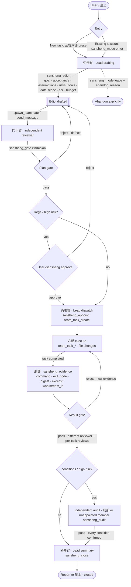

# 三省六部 · Sān Shěng Liù Bù

[简体中文](README.md) | **English**

> **Pronunciation**: Sān **Shěng** Liù Bù. Here 省 means a government department and is read **shěng**, not the *xǐng* of 反省.
> Also known in English as *Three Departments and Six Ministries*.

A **三省六部 mode** for DeepSeek Harness: run the full loop — draft the edict, pass independent review gates, dispatch the six ministries, collect evidence, review the delivery, close the case — inside one session, with a dedicated shared board.

**No shared directory. No temp board.** Every coordination record (edict, gates, appointments, evidence, closure) is an append-only event in the **Lead session's event log**, folded into a `sansheng` session projection. The workspace never holds a second source of truth that another process could rewrite or delete.

---

## What it fixes

Three recurring multi-agent failures:

1. **Self-approval** — the agent that wrote the code also "verifies" it.
2. **Work before review** — the plan is never independently challenged.
3. **Silent loss of progress** — the board lives in a temp directory that gets cleaned, overwritten, or raced.

This plugin turns them into a state machine with **hard gates enforced by tools**:

- the plan must pass an independent 门下省 (teammate) review before any 六部 appointment;
- the reviewer can be neither the Lead nor an appointed ministry member;
- closing fails unless both gates passed and every completed task has evidence;
- state is rebuilt from the session log after resume, fork, or compaction.

## Relationship to the skill

The `three-departments-six-ministries` skill is an optional **procedure document**; the plugin carries its own authoritative tool contract. The plugin is the **execution and audit layer**:

| | Skill | This plugin |
|---|---|---|
| Procedure guidance | ✅ | references the skill, does not duplicate it |
| Tool-level hard gates | ❌ (trust-based) | ✅ (refuses) |
| Dedicated board | ❌ | ✅ (Web conversation header) |
| Durable state | ❌ (optional files) | ✅ (session event log) |

## Install

```sh
dsh plugin --profile web add dsh-experimental-sansheng
```

Or enable it from the Web/Desktop **Plugins** page. This is a standard bundle: one switch mounts the host tools, the session projection, and the browser board together.

For local development, install from the directory:

```sh
dsh plugin --profile web add /absolute/path/to/dsh-experimental-sansheng
```

**Full install (recommended)** — the companion bundle pulls in the core package, mounts the core row, and adds the new-task preset card:

```sh
dsh plugin --profile web add dsh-experimental-sansheng-profile
```

**Core only** (tools + board, manual mode entry):

```sh
dsh plugin --profile web add dsh-experimental-sansheng
```

The preset reuses the host's Standard child-plugin catalog with a Lead persona wearing two hats: 中书省 (planning) and 尚书省 (dispatch/summary). Selecting it starts the session already in the mode; existing Standard sessions are unaffected. Hosts without a preset selector (for example the headless profile) mount only the core row and keep the `sansheng_mode` entry point.

> Why a second package: the preset's loader row must live in a package without a browser half. A package that declares `dsh.client` cannot also carry a second loader row — client-modules rejects one package resolving from two active sources. The companion bundles the declaration only; it is not a browser plugin.

Optional deployment text override:

```yaml
- id: sansheng
  name: dsh-experimental-sansheng
  config:
    section: |-
      (your deployment guidance)
    maxExcerptChars: 2000
```

## Flow

Two entry points:

- pick the **三省六部** preset when creating a task (requires `dsh-experimental-sansheng-profile`) — the session is in the mode from its first turn;
- or, in any existing session, say "enter the 三省六部 mode" / call `sansheng_mode {action:"enter"}`.

Every mutating call echoes the `revision` last read from `sansheng_board` as `expected_revision`; a stale value fails instead of letting a late verdict win.

### How it runs

The mode separates **decision, review and execution**, then turns good intentions into tool-enforced gates:

- **中书省 (Lead, drafting hat)**: receives the intent, plans and drafts the edict; cannot review itself;
- **门下省 (independent teammate)**: reviews the plan and the result; the result reviewer must differ from the plan reviewer and may not own a task;
- **尚书省 (Lead, dispatch hat)**: appoints the ministries, creates shared tasks, coordinates, and summarizes at close;
- **六部**: execute by department; **刑部** records reproducible evidence, and a completed task without evidence cannot close;
- every mutation carries `expected_revision`; a late verdict fails with `STALE_REVISION` instead of overwriting a newer decision.

> **政事堂 is not a fourth department**: it is the Lead's coordinating seat. The same Lead switches hats between 中书省 (drafting) and 尚书省 (dispatch/summary); 门下省 is the genuinely independent reviewer.

### Four-level triage (adapted from 百官)

Before drafting, call `sansheng_triage`; do not default to the full flow:

| Tier | Signals | Handling |
|---|---|---|
| `trivial` | one command/answer/read-only point; no independent review | **do not enter the mode**; if a preset is active, `sansheng_mode {action:"skip", reason:"trivial"}`; answer directly |
| `small` | single-point change needing an independent verifier, no plan gate | Lead + **one independent verifier**; `roster_cap=1`; no plan gate, no ministry appointments; result gate + close |
| `medium` | 2–4 deliverables; plan needs independent review | full flow: plan gate + dispatch + evidence + result gate |
| `large` | multi-module/cross-layer/irreversible/external | full flow + risk analysis + conditional/independent audit |

Three questions: independent review? → independent plan gate? → reviewer supervision? All no = trivial; review only = small; plus plan gate = medium; plus supervision = large. A tier explicitly named by the user wins; the self-assessment is only a cross-check.

### Sequential cases in one session

One active case at a time. After `sansheng_close` or an abandoned leave,
`sansheng_mode {action:"enter"}` starts the next case: the previous case is
archived as a compact `cases[]` summary, all case-scoped fields reset,
`caseId` increments, and the same session log keeps the full audit. The board
shows the current `案卷 #N` and a read-only 宗卷历史 list. Parallel cases are
deliberately unsupported.

### Case state machine (12 phases)

Phases are derived from the session event log; no second state store is kept. `sansheng_board` exposes `phase`:

| Phase | Meaning |
|---|---|
| `idle` | mode not entered |
| `intake` | entered, no edict yet |
| `plan_review` | plan awaiting/receiving review |
| `plan_rejected` | plan rejected by 门下省 |
| `awaiting_human` | large/high-risk plan waits for `/sansheng approve` |
| `dispatching` | plan passed, awaiting 尚书省 appointment |
| `executing` | ministries executing |
| `result_rejected` | delivery rejected |
| `auditing` | conditional/high-risk work awaiting independent audit |
| `ready_to_close` | both gates and audits satisfied |
| `closed` | case closed |
| `abandoned` | explicitly abandoned |

After **3 rejections on one gate**, automatic looping stops and the board escalates to the user.



> A rejected plan must be re-drafted; a rejected result needs fresh evidence. Large or high/irreversible work needs a real user `/sansheng approve` before dispatch; a gate may attach `conditions`, which need a newer passing independent audit before close; high-risk results also need a result audit. Leaving an open case requires closing it or an explicit `abandon_reason`.
>
> **Target model ≠ current build**: this plugin has no unified execution gateway, approval-token validation or six-ministry capability isolation yet; see [docs/architecture.md](docs/architecture.md).

Hard invariants since 0.2.0: stale revisions are rejected; a rejected plan must be re-drafted and a rejected result needs new evidence; plan and result gates need different reviewers, and reviewers may not own a shared task; passes cite `checked` items; evidence only covers completed tasks and needs a hex digest plus excerpt; leaving an open case requires `abandon_reason`; closing rejects unfinished shared tasks.

Since 0.2.2: large-tier appointments need a real user `/sansheng approve` recorded after the plan gate (a model claim is not enough); `/sansheng reject` blocks dispatch until the plan is revised and re-reviewed. Board alerts escalate a stalled board at 30 / 60 / 120 minutes (inspect → interrupt/reassign or report → user decides). Since 0.5.0: high/irreversible risk also needs real-user approval; high-risk edicts need assumptions/risks/tools/data_scope/budget; a gate may carry `conditions`; `sansheng_audit` provides independent condition/high-risk checks and close requires the relevant passing audit.

Any member can read `sansheng_board`; the Lead can also use `sansheng_mode {action:"status"}`. The board's 详细历史 tab keeps a bounded case-level log of message text, tool arguments/results and teammate inbox deliveries, filterable and expandable, with assistant reasoning deliberately excluded. Member-internal trajectories are not copied into the board; open the member session from the native Agent Team panel or the sidebar for the original Chat / Trajectory view. In the right sidebar's guide page (where 工作区文件 / 新建终端 live), an active session gets a **军机处** card; picking it opens that session's board in the same right sidebar: 总览 / 任务 / 审议 / 证据 / 时间线 / 历史. It is neither a left-sidebar global entry nor a floating overlay. The timeline keeps the last 200 mode/edict/appointment/gate/evidence/close records plus rejected (`denied`) tool calls.

## Tools

| Tool | Caller | Purpose |
|---|---|---|
| `sansheng_mode` | Lead (status: any member) | enter / leave / inspect the mode |
| `sansheng_edict` | Lead | goal, acceptance, boundaries, tier, roster, departments, assumptions, risks, tools, data scope, budget |
| `sansheng_appoint` | Lead | appoint one teammate to one 部 |
| `sansheng_gate` | independent teammate | plan/result verdict; rejection needs defects; a pass may carry conditions |
| `sansheng_audit` | independent teammate (刑部 or unappointed) | condition/high-risk audit; auditor cannot own a task or be the gate reviewer |
| `sansheng_evidence` | any member | command, exit code, digest, bounded excerpt, task id |
| `sansheng_close` | Lead | five-part closing report |
| `sansheng_board` | any member | compact board state |

## Hard gates

Tool-enforced, not prompt-enforced:

| Condition | Code |
|---|---|
| non-Lead drafts/appoints/closes | `LEAD_ONLY` |
| appointment before the plan gate | `PLAN_GATE_NOT_PASSED` |
| appointed member reviews its own delivery | `SELF_REVIEW_NOT_ALLOWED` |
| Lead reviews its own plan | `REVIEWER_MUST_BE_TEAMMATE` |
| result gate before plan gate | `PLAN_GATE_NOT_PASSED` |
| rejection without defects | `INVALID_FIELD` |
| pass carrying blocking defects | `DEFECTS_ON_PASS` |
| result gate without evidence | `NO_EVIDENCE_TO_REVIEW` |
| large/high-risk dispatch without real user approval | `USER_APPROVAL_REQUIRED` |
| high-risk edict without assumptions/risks/tools/data scope/budget | `RISK_ANALYSIS_REQUIRED` |
| conditional gate without a newer passing audit | `GATE_CONDITIONS_UNMET` |
| high-risk close without a result audit | `HIGH_RISK_AUDIT_REQUIRED` |
| Lead or gate reviewer tries to audit | `AUDITOR_MUST_BE_TEAMMATE` / `AUDITOR_MUST_BE_INDEPENDENT` |
| task owner tries to audit | `AUDITOR_IS_EXECUTOR` |
| roster cap exceeded | `ROSTER_CAP_EXCEEDED` |
| one member holding several 部 | `MEMBER_ALREADY_APPOINTED` |
| closing with uncovered completed tasks | `COMPLETED_TASK_WITHOUT_EVIDENCE` |
| absolute or `..` write scope | `INVALID_WRITE_SCOPE` |

> Honest scope: **whether a Team task may be marked complete belongs to `team_task_update`, which this plugin cannot intercept.** It also cannot intercept a teammate calling host bash/fs tools directly, and it has no approval-token gateway; ministry role boundaries are declared responsibilities, not a hard sandbox. See [docs/architecture.md](docs/architecture.md). What the plugin does intercept is what decides the delivery verdict: appointment, gate verdicts, audit and closing. Completed tasks without evidence are surfaced in the board's red zone.

## The board

A **三省六部** action appears in the conversation header only while the mode is active. The read-only panel shows the edict, both gates with reviewer and defects, appointments and write scopes, evidence coverage, residual unknowns, closure, and a red zone (no edict, unreviewed plan, rejected plan, gate passed but nothing dispatched, tasks missing evidence).

It reads two session projections — `sansheng` and `agentTeam` — and stores nothing itself, so it cannot drift from the log.

## State and persistence

The board **never writes a custom session event type**. DSH's session format only lets the host append ignorable experimental records; an unknown non-ignorable type makes the whole session refuse to reconstruct after restart ("unknown to this harness and not marked ignorable"). Real-machine verification caught this in an earlier build, and it is fixed.

Board state therefore travels only through events DSH already knows and can replay:

| Source | Event type | Payload |
|---|---|---|
| the Lead's own `sansheng_*` tool calls | `tool/result` | the tool's record envelope (`{"sansheng":1,"op":...}`) |
| 门下省/六部 teammate tool calls | `user/message` (Team message) | the tool **auto-publishes** the record to the Lead as a Team message; the `SANS_RECORD_V1` marker lets the projection find it among ordinary prose |

The projection folds only those two families, so **restart, resume, fork, and compaction are safe**, and no file is involved. **No `.team/`, no `/tmp` board, no coordination file.**

## Relationship to Agent Teams

The plugin depends on DSH Agent Teams (`@deepseek-ai/dsh-experimental-agent-team-profile`). Roster, messaging, tasks, and waiting stay native; 三省六部 only adds the governance layer. The large tier needs `maxMembers ≥ 9` (the shipped bundle defaults to 8):

```yaml
- id: agent-team
  config:
    maxMembers: 12
```

## Optional workstreams

An edict may declare per-department delivery units:

```json
"workstreams": [
  {"id": "api", "department": "工部", "deliverable": "endpoint",
   "acceptance": ["endpoint tests pass"], "write_scopes": ["src/api"]}
]
```

With workstreams declared, evidence must name `workstream_id`, a passing result gate must review every workstream, and close rejects a workstream without evidence. Re-drafting the edict invalidates the previous plan pass.

## Pre-install doctor

```sh
npm run doctor -- --host-version 0.2.1-rc.2
```

Checks package integrity, core/companion version sync and the host support matrix (`compatibility.json`).

## Known limitations

- **The preset catalog mirrors the host's Standard preset**: `preset-bundle/cordis.patch.yml` copies the current Standard child-plugin list. Re-sync it and release when a DSH upgrade changes Standard.
- Hosts without agent presets (headless) mount only the tools; entry falls back to `sansheng_mode`.
- Client plugins load per profile: refresh an already-open page after enabling/disabling.
- Single process, shared checkout: write scopes are advisory; the Lead still reviews the final diff.
- Reviewer granularity currently uses "reviewer is not an appointed ministry member" as the proxy for "author ≠ reviewer"; per-task authorship tracking is future work.
- Experimental: tool names and event schemas may change within a minor version.

## Development and publishing

```sh
npm install        # only needed for the host smoke tests
npm run verify     # node --check + node --test
npm pack --dry-run # inspect the published payload
```

Publish (requires npm login and ownership of the name):

```sh
npm login
npm version patch
npm publish --access public
```

## License

MIT
