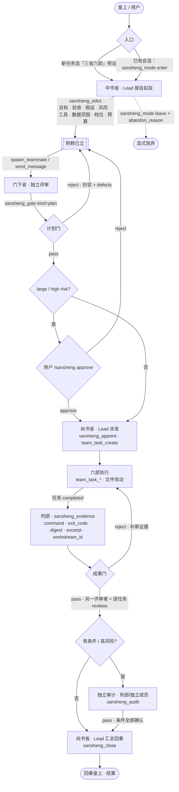

# 三省六部 · Sān Shěng Liù Bù

**简体中文** | [English](README.en.md)

> **读音**：Sān **Shěng** Liù Bù。这里的“省”是官署，读 **shěng**，不是“反省”的 xǐng。
> 英文：Three Departments and Six Ministries。

为 DeepSeek Harness 增加一个 **三省六部模式**：在一个会话内完成“拟旨 → 门下审议 → 派工 → 六部执行 → 刑部取证 → 门下覆核 → 结案回奏”的完整闭环，并提供一个**专属共享任务看板**。

**这个插件不依赖任何共享目录/临时白板。** 所有协调状态（制敕、门禁、任命、证据、结案）都以 append-only 事件写进 **Lead 会话的事件日志**，由 `sansheng` 会话投影折叠出看板。工作区里没有第二个真源，也不存在被外部进程篡改或误删的“任务文件”。

---

## 目录

- [它解决什么问题](#它解决什么问题)
- [与技能的区别](#与技能的区别)
- [安装](#安装)
- [使用流程](#使用流程)
- [工具](#工具)
- [硬门（不是提示词，是工具拒绝）](#硬门)
- [专属看板](#专属看板)
- [状态与持久化](#状态与持久化)
- [与 Agent Teams 的关系](#与-agent-teams-的关系)
- [已知限制](#已知限制)
- [开发与发布](#开发与发布)
- [License](#license)

## 它解决什么问题

多智能体协作最常见的三种事故：

1. **作者自批**：写代码的那个顺手“验证”一下，等于没有复核。
2. **未过门就动手**：计划没人审，返工从第一步开始。
3. **静默停摆 / 进度丢失**：任务存在临时目录里，被清理、被覆盖、被并发写坏。

三省六部模式把这三件事变成**状态机 + 硬门**：

- 计划必须先由**独立门下省**（teammate）审议通过，才能任命六部；
- 复核者不能是 Lead，也不能是被任命的六部成员；
- 结案必须两门都过、每个已完成任务都有刑部证据，否则 `sansheng_close` 直接失败；
- 状态全部在会话日志里，恢复、fork、压缩后仍可重建。

## 与技能的区别

`three-departments-six-ministries` 技能（同名的 skill）是**可选的流程背景**；插件自带权威工具契约。它告诉模型该怎么做，但无法阻止模型偷懒。

本插件是**执行与审计层**：

| | 技能 | 本插件 |
|---|---|---|
| 流程说明 | ✅ | 引用技能，不重复 |
| 工具级硬门 | ❌（靠自觉） | ✅（越权直接报错） |
| 专属看板 | ❌ | ✅（Web 会话页头） |
| 状态持久化 | ❌（可选文件） | ✅（会话事件日志） |

## 安装

发布到 npm 后：

```sh
dsh plugin --profile web add dsh-experimental-sansheng
```

或在 Web/Desktop 的**插件**页搜索 `dsh-experimental-sansheng` 并开启。这是标准 bundle：只要这一行启用，宿主工具、会话投影与浏览器看板同时生效。

本地开发时可以直接从目录安装：

```sh
dsh plugin --profile web add /absolute/path/to/dsh-experimental-sansheng
```

**完整安装（推荐）**：装配套 bundle，它会自动带上核心包，并同时挂载核心行与预设卡：

```sh
dsh plugin --profile web add dsh-experimental-sansheng-profile
```

**只装核心包**（工具 + 看板，手动进入模式）：

```sh
dsh plugin --profile web add dsh-experimental-sansheng
```

预设卡复用宿主 Standard 的子插件清单，外加一个戴「中书省（规划）/ 尚书省（派发汇总）」两顶帽子的 Lead persona。选中它创建会话，该会话**从第一轮起就处于三省六部模式**，不需要手动进入；已有 Standard 会话不受影响。没有预设选择器的宿主（例如 headless profile）只挂载核心行，入口退化为 `sansheng_mode`。

> 预设声明为什么单独一个包：bundle 的 loader 行要指向一个**不含浏览器半边**的包，才能避开 client-modules 对同一包出现多个来源的冲突；核心包的 `dsh.client` 与第二行不能同包共存。

默认引导文本可以用插件配置覆盖：

```yaml
- id: sansheng
  name: dsh-experimental-sansheng
  config:
    section: |-
      （你的部署版三省六部引导）
    maxExcerptChars: 2000
```

## 使用流程

两种入口：

- **新建会话时选「三省六部」预设卡**（需安装 `dsh-experimental-sansheng-profile`）：该会话首轮即处于模式中；
- **任意已有会话**：对 Lead 说“进入三省六部模式”，或调用 `sansheng_mode {action:"enter"}`。

进入后按顺序（**每次修改前先从 `sansheng_board` 读 `revision`，作为 `expected_revision` 传入**）：

### 运行机制

核心是**决策、复核、执行分离**，再用工具门把“自觉”变成“拒绝”：

- **中书省（Lead 拟旨阶段）**：接旨、规划、拆解，产出制敕；不能自审；
- **门下省（独立 teammate）**：审计划、审成果；必须换人复审，且不能是任务执行者；
- **尚书省（Lead 派发阶段）**：任命六部、建共享任务、协调进度、汇总回奏；
- **六部**：按部门执行；**刑部**登记可复现证据，没有证据的完成项不能结案；
- 所有写操作都带 `expected_revision`，迟到的评审会被 `STALE_REVISION` 拒绝，不会覆盖新结论。

> **政事堂不是第四省**：它是 Lead 的协调位。同一位 Lead 在“中书省（拟旨）→ 尚书省（派发/汇总）”之间切换帽子；真正独立的是门下省。

### 四级判档（从百官吸收）

开衙前先调用 `sansheng_triage`，不要默认走完整流程：

| 档位 | 判据 | 处理 |
|---|---|---|
| `trivial` 顺手事 | 一条命令/一次回答/单点只读，不需要独立复核 | **不进模式**；若预设已激活，`sansheng_mode {action:"skip", reason:"trivial"}`；直接完成 |
| `small` 小事 | 单点改动，需要独立 verifier，但不需要计划门 | Lead + **1 名独立 verifier**；`roster_cap=1`；无计划门、不任命六部；结果门 + 结案 |
| `medium` 中事 | 2–4 个交付物，计划需要独立封驳 | 完整流程：计划门 + 派工 + 证据 + 成果门 |
| `large` 大事 | 多模块/跨层/不可逆/外部依赖 | 完整流程 + 风险分析 + 条件/独立审计 |

判档三问：**需要独立复核？→ 需要独立计划封驳？→ 需要监督复核者？** 三问全否 = trivial；只需复核 = small；再加计划门 = medium；再加监督 = large。

如果用户明确说“这是小事/按中事办”，**以用户的档为准**，`sansheng_triage` 的自评只用于提醒偏差，不擅自升降。

### 顺序宗卷（同一会话）

默认一个会话同时只有一个活动宗卷。结案（`sansheng_close`）或放弃离开后，再调用
`sansheng_mode {action:"enter"}` 会：

1. 把上一单归档为一条 `cases[]` 摘要（目标、档位、结案/放弃、原因）；
2. 清空制敕/门禁/证据/审计/御批/结案字段；
3. `caseId + 1`，继续使用同一个会话日志与 revision，旧单的完整审计仍在日志和「详细历史」中。

看板显示当前「案卷 #N」，总览底部有只读的「宗卷历史」。**不支持并行宗卷**：同一时刻只有一个活动宗卷。

### 案卷状态机（12 态）

状态不额外存储，由会话事件日志派生；`sansheng_board` 的 `phase` 字段直接可见：

| 状态 | 含义 |
|---|---|
| `idle` | 未进入模式 |
| `intake` | 已进入，尚未拟旨 |
| `plan_review` | 计划待审/审议中 |
| `plan_rejected` | 计划被门下封驳 |
| `awaiting_human` | large/高风险计划等待 `/sansheng approve` |
| `dispatching` | 计划已过门，待尚书省派工 |
| `executing` | 六部执行中 |
| `result_rejected` | 成果被门下封驳 |
| `auditing` | 有条件通过或高风险，等待独立审计 |
| `ready_to_close` | 两门通过、证据/审计齐备，可结案 |
| `closed` | 已结案 |
| `abandoned` | 显式放弃 |

同一门 **封驳 ≥3 轮** 时停止自动循环，告警升级为用户裁决（见红区）。



> 计划被封驳 → 改旨重审；成果被封驳 → 补新证据再审。large 或 high/irreversible 风险必须由用户 `/sansheng approve` 后才能派工；门禁可带 `conditions`，结案前须由独立审计逐条确认；高风险成果还需结果审计。离开模式必须先结案或显式放弃。
>
> **目标态 ≠ 当前实现**：本插件还没有统一的工具网关、批准令牌校验或六部权限隔离；详见 [docs/architecture.md](docs/architecture.md)。

硬约束（0.2.0 起）：

- **修订号 CAS**：`expected_revision` 过期会被拒（`STALE_REVISION`），不会让迟到的评审覆盖先前的结论。
- **封驳必须重做**：计划被 reject 后必须重新 `sansheng_edict` 才能再 pass；成果被 reject 后必须补新证据。
- **评审者独立**：计划门与成果门必须由不同 teammate 审；评审者不得是任何共享任务的执行者。
- **通过要有凭据**：pass 必须带 `checked`；成果门 pass 还必须带每个已完成任务的 `reviews`。
- **证据硬化**：证据只能覆盖**已完成**任务，必须带十六进制 `digest` 和非空 `excerpt`，重复证据被拒。
- **离开模式**：必须先 `sansheng_close`，或传 `abandon_reason` 显式放弃（看板记录）。
- **结案**：所有共享任务必须处于 completed/deleted，不能带着未完成任务结案。
- **御批（large / 高风险）**：计划门通过后，large 档或 `risk_level=high/irreversible` 需用户在 Lead 会话运行 `/sansheng approve [备注]`（或 reject）才能任命六部；模型自称用户同意无效，御批来自真实 `command/run` 事件。
- **假设与风险**：high/irreversible 制敕必须列出 assumptions、risks、tools、data_scope 和 budget，否则 `RISK_ANALYSIS_REQUIRED`。
- **有条件通过**：`sansheng_gate` 的 pass 可带 `conditions`；结案前必须有更新的独立审计逐条确认，否则 `GATE_CONDITIONS_UNMET`。
- **独立审计**：`sansheng_audit` 只能由独立 teammate 调用；刑部可审，其他被任命部门不可；审计者不能拥有任务或担任该门评审者；高风险结案必须有通过的 result 审计。
- **停滞升级**：看板 30 分钟无新记录→先查停滞成员；60 分钟→interrupt/reassign 或上奏；120 分钟→必须由用户决定，不得自行放宽验收。

任意成员都可以随时 `sansheng_board` 读当前看板；Lead 可以 `sansheng_mode {action:"status"}` 查看摘要。看板的「详细历史」页签保留案卷级事件历史：消息正文、工具调用参数/结果、团队来信，按时间排列、可筛选可展开（不含模型思考，最多保留最近 240 条 / 120k 字符）。成员内部轨迹不复制进看板，请从官方 Agent Team 面板或侧栏的成员会话打开 DSH 原生 Chat / Trajectory。会话页头的「三省六部」按钮会打开完整看板抽屉：**总览 / 任务 / 审议 / 证据 / 时间线 / 详细历史**六个页签；模式激活时会自动打开。时间线包含被拒绝的调用（denied）与所有模式/拟旨/任命/审议/取证/结案记录，模式激活后会保留最近 200 条。

## 工具

| 工具 | 调用者 | 作用 |
|---|---|---|
| `sansheng_mode` | Lead（status 任意成员） | 进入/离开/查看模式 |
| `sansheng_edict` | Lead | 拟旨：目标、验收、边界、档位、编制、部门、假设、风险、工具、数据范围、预算 |
| `sansheng_appoint` | Lead | 任命一个 部（一人一部，写作用域仅提示） |
| `sansheng_gate` | 独立 teammate | 计划门 / 成果门：`pass`/`reject`（封驳必须带缺陷清单）；pass 可带 `conditions` |
| `sansheng_audit` | 独立 teammate（刑部或独立成员） | 独立审计条件/高风险成果；审计者不能拥有任务或是该门评审者 |
| `sansheng_evidence` | 任意成员（通常刑部） | 登记可复现证据：命令、退出码、digest、有界摘录、关联任务 |
| `sansheng_close` | Lead | 结案/回奏：结论、交付物、残留未知、下一步 |
| `sansheng_board` | 任意成员 | 读紧凑看板状态 |

## 硬门

这些不是提示词约束，而是工具直接抛错：

| 条件 | 错误码 |
|---|---|
| 非 Lead 拟旨/任命/结案 | `LEAD_ONLY` |
| 计划门未过就任命六部 | `PLAN_GATE_NOT_PASSED` |
| 六部成员想复核自己的交付 | `SELF_REVIEW_NOT_ALLOWED` |
| Lead 想当复核者 | `REVIEWER_MUST_BE_TEAMMATE` |
| 成果门先于计划门 | `PLAN_GATE_NOT_PASSED` |
| 封驳但没写缺陷 | `INVALID_FIELD` |
| 通过却带“阻塞缺陷” | `DEFECTS_ON_PASS` |
| 没有证据就要过成果门 | `NO_EVIDENCE_TO_REVIEW` |
| large/高风险未获真实用户御批就派工 | `USER_APPROVAL_REQUIRED` |
| 高风险制敕缺 assumptions/risks/tools/data_scope/budget | `RISK_ANALYSIS_REQUIRED` |
| 有条件通过但没有更新的通过审计 | `GATE_CONDITIONS_UNMET` |
| 高风险结案没有 result 审计 | `HIGH_RISK_AUDIT_REQUIRED` |
| Lead 或该门评审者想审计 | `AUDITOR_MUST_BE_TEAMMATE` / `AUDITOR_MUST_BE_INDEPENDENT` |
| 任务执行者想审计 | `AUDITOR_IS_EXECUTOR` |
| 超编制上限任命 | `ROSTER_CAP_EXCEEDED` |
| 同一成员兼任多个部 | `MEMBER_ALREADY_APPOINTED` |
| 已完成任务缺证据就结案 | `COMPLETED_TASK_WITHOUT_EVIDENCE` |
| 有绝对路径/`..` 的写作用域 | `INVALID_WRITE_SCOPE` |

> 诚实说明：**“任务能不能标完成”本身是 Team 工具（`team_task_update`）的域，本插件拦不住**。  
> 同样，本插件不能拦截队友直接调用宿主的 bash/fs 工具，也没有批准令牌网关；六部角色边界是责任声明，不是硬沙箱。详见 [docs/architecture.md](docs/architecture.md)。
> 本插件拦的是**“能不能任命、能不能过门、能不能结案”**这三件真正决定交付结论的事；未过门就完成的任务会由看板红区标出。

## 专属看板

会话页头出现 **三省六部** 按钮（只在模式激活时出现），点击打开只读面板：

- **制敕**：目标、档位、编制上限、需要的部门；
- **计划门 / 成果门**：verdict、复核者、缺陷清单；
- **编制**：谁被任命到哪个部、写作用域；
- **证据**：已登记数量、已完成任务数、缺证据任务（红）；
- **结案**：结论、交付物、残留未知；
- **红区**：未拟旨、计划未审、计划被驳、已过门未派工、任务缺证据。

看板读两个会话投影：`sansheng`（本插件发布的看板状态）与 `agentTeam`（Team 名册与任务）。**它是只读投影，不存自己的状态**，因此不会与日志漂移。

## 状态与持久化

看板**不写自定义会话事件类型**。DSH 的会话格式只允许宿主自己写入可忽略（ignorable）的实验性事件；第三方插件写未知类型会导致**重启/恢复时整个会话被拒绝解释**（"unknown to this harness and not marked ignorable"）。这是本项目在真机验证中抓到并修掉的问题。

因此状态全部走 DSH 已知、可回放的事件通道：

| 来源 | 事件类型 | 携带内容 |
|---|---|---|
| Lead 自己的 `sansheng_*` 工具调用 | `tool/result` | 工具返回的记录信封（`{"sansheng":1,"op":...}`） |
| 门下省/六部成员的工具调用 | `user/message`（Team 消息） | 成员工具会把记录**自动以 Team 消息发给 Lead**；标记 `SANS_RECORD_V1` 让投影把它从普通消息中识别出来 |

看板投影只折叠这两类事件，因此**重启、恢复、fork、压缩都安全**，且不依赖任何文件。

**没有 `.team/`、没有 `/tmp` 白板、没有可被其他进程改写的任务文件。** 想验证这一点：重启 DSH 进程后重新打开会话，看板状态应完全一致（本项目的验收项之一）。

## 与 Agent Teams 的关系

本插件依赖 DSH 的 Agent Teams（`@deepseek-ai/dsh-experimental-agent-team-profile`）：

- 成员、消息、共享任务板仍然用 Team 的原生工具；
- 三省六部只增加**治理层**（制敕/门禁/证据/编制/结案）；
- 大事档需要 `maxMembers ≥ 9`（官方组合包默认 8），建议在 profile patch 覆盖：

```yaml
- id: agent-team
  config:
    maxMembers: 12
```

## 可选：逐任务工作流（workstreams）

制敕可以声明按部门拆分的交付单元：

```json
"workstreams": [
  {"id": "api", "department": "工部", "deliverable": "接口实现",
   "acceptance": ["接口测试通过"], "write_scopes": ["src/api"]}
]
```

声明后：证据必须带 `workstream_id`；成果门 pass 必须覆盖每个 workstream 的 review；结案前每个 workstream 都必须有证据。改稿（重新 `sansheng_edict`）会让之前的计划门失效，必须重审。

## 安装前自检

```sh
npm run doctor -- --host-version 0.2.1-rc.2
```

检查包完整性、核心/配套版本同步与宿主支持矩阵（见 `compatibility.json`）。

## 已知限制

- **预设清单随宿主同步**：配套包 `preset-bundle/cordis.patch.yml` 复制了当前宿主 Standard 预设的子插件清单（工具、压缩、委派等）。DSH 升级后如果 Standard 清单变化，需要同步更新该文件并重新发版。
- **无预设的宿主**（headless）：只挂载工具，模式入口退化为 `sansheng_mode`。
- **浏览器插件按 profile 加载**：启用/禁用后已有页面可能需要刷新。
- **单进程、共享 checkout**：写作用域只是提示，Bash/格式化工具仍可能越界；Lead 必须做最终 diff 审查。
- **复核者粒度**：目前用“复核者不得是被任命的六部成员”来近似“作者 ≠ 复核者”；更细的任务级作者追踪会在后续版本加入。
- **实验性**：schema 与工具名可能在小版本内调整。

## 开发与发布

```sh
npm install        # 只为本地跑 host 测试
npm run verify     # node --check + node --test
npm pack --dry-run # 检查发布内容
```

发布（需要 npm 登录且拥有该包名）：

```sh
npm login
npm version patch   # 或 minor
npm publish --access public
```

发布物包含：`index.js`（host）、`client.js`（浏览器）、`cordis.patch.yml`（bundle 行）、`src/policy.js`（纯策略层）与文档；`prepack` 会自动跑 `verify`。

目录：

```text
index.js          host 半边：工具 / 投影 / 提示词段落
client.js         浏览器半边：页头按钮 + 看板面板
cordis.patch.yml  bundle 补丁（插入一行）
src/policy.js     纯策略：状态折叠 + 硬门校验（无依赖，可直接单测）
test/             policy 单测 + host 注册冒烟测试
```

## License

MIT
